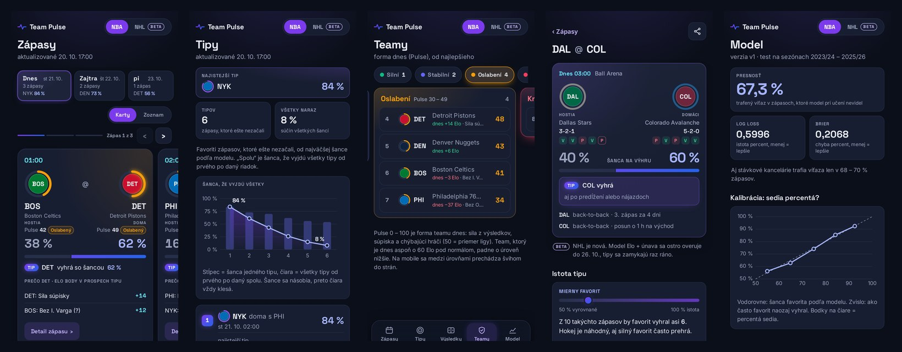
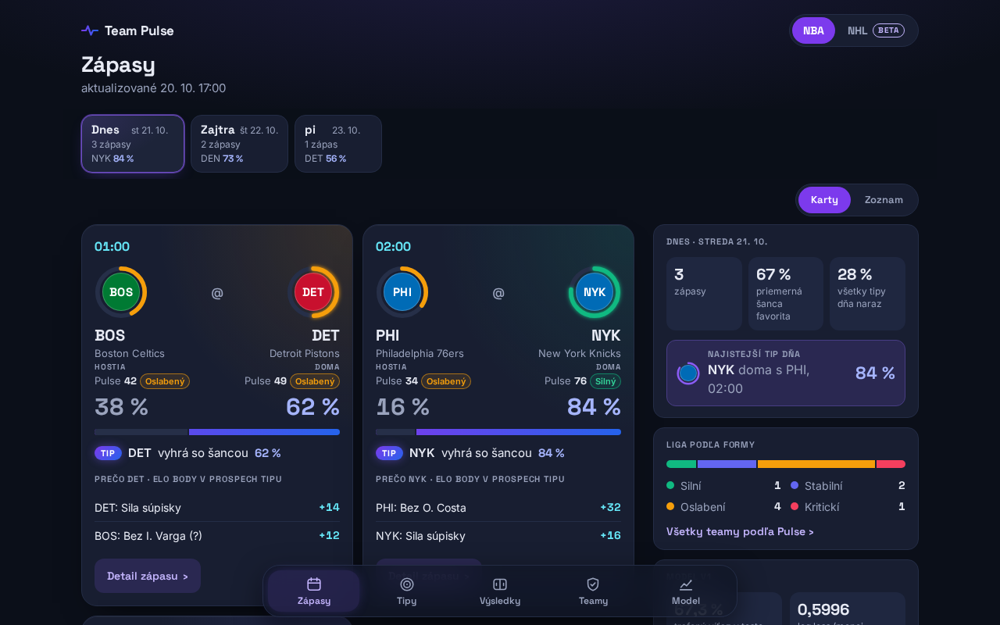
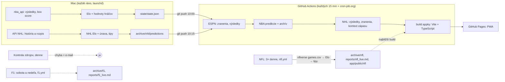

# Team Pulse

[](https://github.com/peterolah-qa/team-pulse/actions/workflows/ci.yml)
[](https://github.com/peterolah-qa/team-pulse/actions/workflows/app.yml)
[](https://github.com/peterolah-qa/team-pulse/actions/workflows/predict.yml)
[](https://github.com/peterolah-qa/team-pulse/actions/workflows/nfl.yml)

**V akom stave je team pred zápasom a kto má väčšiu šancu vyhrať?** Team Pulse to pri NBA vyhodnotí
v 4 úrovniach (Silný / Stabilný / Oslabený / Kritický), povie prečo, ako veľmi si je istý a čo sa zmení,
ak otázny hráč nenastúpi. V appke sú **NBA, NHL a NFL (beta)**: NHL 28. 10. prešla ostrým overením G2,
NFL je v appke od 28. 10. a jej ostré meranie beží do 10. 1. 2027. F1 sa meria naostro mimo appky, tenis sa
pripravuje na január, bejzbal je pozastavený.

**→ [peterolah-qa.github.io/team-pulse](https://peterolah-qa.github.io/team-pulse/)** (appka sa dá nainštalovať na mobil)

> *In English:* a personal, non-commercial project. It is a web app (PWA) that rates each NBA team's
> condition before a game and gives the model's win probability, for NBA, NHL and NFL (beta). The NBA model
> is an Elo model replicated from FiveThirtyEight plus learned layers for player availability, fatigue and
> roster strength; the NHL model is Elo plus fatigue; the NFL model is FiveThirtyEight-style Elo, with a second
> model that adds a backup-quarterback adjustment. Everything runs on free data and free infrastructure.
> The project also serves as a QA-automation portfolio piece: see [Testing](#testovanie).



Team Pulse je len na orientáciu. **Neukazuje kurzy a neodkazuje na stávkové kancelárie.** „Tip“ v appke
je team, ktorému model dáva väčšiu šancu na výhru; karta Tipy ich len zoradí podľa šance a ukáže,
s akou šancou vyjdú všetky naraz. Nie je spojený s NBA, NHL, NFL ani s ich klubmi a nepoužíva ich logá
(len farby dresov a skratky).

---

## Čo appka ukazuje

| Obrazovka | Obsah |
|---|---|
| **Zápasy** | pás dní (počet zápasov a najistejší tip dňa), zápasy ako **balíček kariet** (švih do strán, šípky, „Zápas 2 z 3“) alebo zoznam; na karte šanca, tip, Pulse teamov a najviac 4 dôvody v Elo bodoch v prospech tipu; vedľa prehľad dňa (šanca, že vyjdú všetky tipy dňa, najistejší tip, liga podľa formy, model) |
| **Tipy** | favoriti zápasov, ktoré ešte nezačali, od najväčšej šance nadol; ukazovatele (najistejší tip, počet, všetky naraz) a graf: stĺpec = šanca tipu, čiara = šanca, že vyjdú všetky tipy od prvého po daný (súčin šancí) |
| **Výsledky** | dohrané zápasy posledných dní so skóre a naším tipom pred zápasom (nevyšiel = červený); v detaile štatistiky hráčov |
| **Zápas (NBA)** | tip a šanca, prečo (najviac 4 dôvody), čo ak otázny hráč nenastúpi, forma teamov s grafom Pulse; vrstvy modelu po rozkliknutí |
| **Zápas (NHL)** | istota tipu, **prečo X %** v Elo bodoch (súčet presne sedí na zamknutú šancu), Elo trend, odpočinok a cestovanie, forma v sezóne, porovnanie s poradím v lige, vzájomné zápasy, chýbajúci hráči, zdieľanie a **Sledovať zápas** |
| **Zápas (NFL, beta)** | istota tipu, **prečo X %** v Elo bodoch (rozdiel Ela, domáce ihrisko, play-off; súčet presne na zamknutú šancu, **overený prepočtom** z aktuálnych výsledkov), quarterbacky v čase zamknutia a šanca druhého modelu (Elo + quarterback, od 10. týždňa), Elo trend, týždeň a bilancia |
| **Team** | Pulse a poradie podľa formy, najbližšie zápasy s našou šancou, posledné výsledky, súpiska so zranenými navrchu |
| **Teamy** | NBA: liga v 4 úrovniach Silní / Stabilní / Oslabení / Kritickí ako karusel so záložkami (na počítači 4 stĺpce), pri teame Pulse a posun oproti normálu s hlavným dôvodom; NHL a NFL: liga podľa Ela (NFL s bilanciou) |
| **Model** | presnosť, log loss a Brier na neznámych zápasoch, kalibrácia, prínos každej vrstvy modelu; váhy po rozkliknutí |

**Vzhľad („Luminous Pulse“):** tmavý analytický terminál, farba nesie význam. Úrovne formy majú vlastné
farby (Silný smaragd, Stabilný indigo, Oslabený jantár, Kritický rubín), tip je fialovo-modrá žiara,
nie stávková žltá. Odznak teamu je kruh vo farbách dresu so skratkou a prstencom: pri NBA Pulse, pri NHL
šanca na výhru. Písmo Space Grotesk a Inter, číslice rovnako široké. Na počítači sú Zápasy prehľad
v dvoch stĺpcoch. Appka má tmavú aj svetlú tému podľa nastavenia systému. Ikona: tmavý squircle s radarovými
kruhmi a neónovou EKG krivkou z fialovej do smaragdovej so žiariacim vrcholom (verzie pre Android, iOS aj počítač).

**Pulse** = 50 + (Elo dnes − 1505) / 6, teda 50 znamená priemerný team. Hranice úrovní sú 70 / 50 / 30.
Team, ktorý je dnes aspoň o 60 Elo pod svojím normálom (napr. mu chýba hviezda), padne o úroveň nižšie.

**NHL** – prepínač NBA / NHL / NFL hore. Tipy zamyká ranná NHL úloha na Macu (`archive/nhl/predictions`),
GitHub Actions k nim pri každom builde pridá výsledky z API NHL, zranenia z ESPN a kontext zápasu
(`team_pulse.nhl.context`): z rozpisov klubov znova spočíta vstupy modelu a overí, že dajú presne zamknutú
šancu, a doplní formu, odpočinok, vzájomné zápasy a štatistiky NHL (len keď počet zápasov a výhier sedí
s rozpisom). Tlačidlo **Sledovať zápas** ukáže v appke výsledok a či tip vyšiel, keď sa zápas dohrá.
Brána G2-NHL (13. – 26. 10. 2026) je splnená: tip vyšiel v 59 z 98 zápasov (60,2 %), log loss 0,6686
pri hranici 0,7101, označenie beta zmizlo ([reports/gate_g2_nhl.md](reports/gate_g2_nhl.md)).

**NFL (beta)** – tipy zamyká GitHub Actions (`nfl.yml`, 3× denne): celý najbližší týždeň, len čo je predchádzajúci
dohraný, vždy pred výkopom; do tipu sa uloží aj očakávaný štartujúci quarterback a verzia dát. Ku každému zápasu
sú dva tipy: **Elo** (hlavný, meria ho brána G2-NFL) a od 10. týždňa **Elo + quarterback** (G2-NFL-QB). Ten istý beh
vyhodnotí výsledky ([reports/nfl_live.md](reports/nfl_live.md)) a zapíše dáta pre appku do `app/public/nfl`;
build appky ich zverejní. Prvé tipy: 8. týždeň, zamknuté 28. 10. 2026.



## Športy a brány

Každý šport má vlastný model a vlastné brány, hranice sa stanovia pred meraním ([plán](docs/sporty.md)).

| Šport | Model | Backtest (G0) | Ostré meranie (G2) | Stav |
|---|---|---|---|---|
| **NBA** | Elo + únava + hráči + sila súpisky | ✅ [G0](docs/gate-G0.md), [G1](docs/gate-G1.md) | 20. 10. – 2. 11. 2026, vyhodnotenie 3. 11. ([G2](docs/gate-G2.md)); priebežne k 28. 10.: 56 zápasov, 64,3 %, log loss 0,6236 | v appke |
| **NHL** | Elo + únava | ✅ [G0-NHL](docs/gate-nhl-G0.md) | ✅ [G2-NHL](docs/gate-nhl-G2.md) 13. – 26. 10. 2026: 98 zápasov, tip vyšiel 60,2 %, log loss 0,6686 (hranica 0,7101), [výsledok](reports/gate_g2_nhl.md) | v appke |
| **NFL** | Elo podľa 538; druhý model + náhradník quarterback ([plán](docs/nfl.md)) | ✅ [G0-NFL](docs/gate-nfl-G0.md): Elo 63,9 %, log loss 0,6341 vs. 0,6611; quarterback 64,4 %, 0,6305 ([report](reports/nfl_qb.md)) | [G2-NFL](docs/gate-nfl-G2.md) Elo týždne 8 – 18 (do 10. 1. 2027, hranica 0,6620); [G2-NFL-QB](docs/gate-nfl-qb-G2.md) týždne 10 – 18 (hranica 0,6602) | v appke ako beta |
| **F1** | Elo jazdca a tímu + kvalifikácia | ❌ [G0-F1](docs/gate-f1-G0.md): horší než kvalifikácia | model B naostro mimo appky, 6 pretekov 25. 10. – 6. 12. 2026 ([docs/gate-f1-shadow.md](docs/gate-f1-shadow.md)); po Austine favorit 1 z 1 | tip po kvalifikácii, `f1.yml` |
| **Tipos extraliga** | hokejové Elo z NHL | – | – | čaká na súhlas SZĽH so zdrojom dát |
| **Bejzbal** (MLB) | Elo + štartujúci nadhadzovač ([plán](docs/baseball.md)) | – | od 25. 3. 2027 | zdroje overené, pozastavené |
| **Tenis** (ATP, WTA) | Elo hráča + povrch ([plán](docs/tennis.md)) | kritériá [G0](docs/gate-tennis-G0.md) stanovené vopred, backtest do polovice decembra | Australian Open 17. – 31. 1. 2027 | zdroje overené, model |

Brány G2 vyhodnocuje skript nezávislým prepočtom z archívu, nie z reportu:
`uv run python -m team_pulse.gate_g2 nba|nhl` → `reports/gate_g2_<šport>.md`. Počas G2 sa model,
predikcie, archív, ranné úlohy ani `predict.yml` daného športu nemenia; appka (obrazovky) áno, len so
zelenými testami.

## Ako to funguje



- **Mac** robí ťažkú prácu, lebo stats.nba.com často blokuje požiadavky z cloudových serverov. NBA úloha
  (10:00) zapíše malý súbor stavu, NHL úloha (10:15) vyhodnotí noc a zamkne tipy na ďalšie zápasy.
- **GitHub Actions** každých 15 minút stiahne zranenia, prepočíta predpovede a nasadí appku. Plánované behy
  GitHubu často meškajú, preto ich každých 30 minút spúšťa aj cron-job.org (`workflow_dispatch`).
- **Archív predpovedí:** do 24 hodín pred zápasom cloud uloží predpoveď do `archive/predictions/`, kým zápas nezačne, prepisuje ju novšou; po začiatku sa už nemení. Archív sa commitne pred buildom appky, takže chyba appky ho nepokazí. Mac ráno doplní výsledky (`archive/results/`) a prepíše [reports/live.md](reports/live.md) s presnosťou, log loss a kalibráciou ostrej prevádzky (NHL: [reports/nhl_live.md](reports/nhl_live.md)).
- **Výsledky:** dohrané zápasy posledných dní so skóre a naším tipom pred zápasom; v detaile štatistiky hráčov (minúty, body, doskoky, asistencie, bloky, zisky). Cloud ich berie z ESPN hneď po zápase (aj z prípravy) a ukladá do `archive/boxscores/`; ranný box score z Macu (nba_api) má prednosť.
- **Príprava:** prípravné zápasy appka ukazuje so štítkom PRÍPRAVA. Do Ela, únavy v sezóne ani do vyhodnotenia sa nerátajú; v archíve slúžia ako skúška pred sezónou.
- **NFL** beží celé v GitHub Actions (`nfl.yml`): stiahne najnovší `games.csv` z nflverse (stávkové stĺpce sa
  nenačítajú), prepočíta Elo, zamkne tipy najbližšieho týždňa, vyhodnotí výsledky a zapíše dáta pre appku.
- **Náklady: 0 €.** Repo je verejné, Pages a Actions sú zadarmo a všetky zdroje dát sú voľné.

## Model

### NBA

Základ je **Elo podľa FiveThirtyEight**. Je replikovaný a overený proti ich archívu: K = 20 · (MOV + 3)^0,8 / (7,5 + 0,006 · D),
výhoda domáceho prostredia a prenos medzi sezónami 0,75 · R + 0,25 · 1505. Nad ním sú naučené vrstvy:

- **B – hráči:** hodnota hráča z PIE a očakávané minúty. Chýbajúca kvalita sa násobí pravdepodobnosťou, že hráč nenastúpi.
- **C – únava a cestovanie:** odpočinok, back-to-back, 3 zápasy za 4 dni, kilometre, posun časových pásiem, nadmorská výška.
  Rátajú sa aj neutrálne ihriská (Mexico City, Paríž, Londýn, Berlín, Abú Zabí) a bublina 2020.
- **Sila súpisky:** top 11 hráčov podľa bežných minút.

Váhy sa učia logistickou regresiou na sezónach 2003/04 – 2022/23. Testujú sa na 2023/24 – 2025/26,
teda na zápasoch, ktoré model pri učení nevidel:

| Model | Presnosť | Log loss | Brier |
|---|---:|---:|---:|
| A: Elo (HCA 70) | 66,4 % | 0,6108 | 0,2116 |
| A + C (únava) | 66,8 % | 0,6081 | 0,2104 |
| A + B + C (chýbajúci hráči) | 67,3 % | 0,6039 | 0,2087 |
| **A + B + C + sila súpisky = v1** | **67,3 %** | **0,5996** | **0,2068** |

Vrstva sa do modelu dostala, len ak zlepšila log loss aspoň o 0,0005. Túto hranicu som stanovil vopred.
Pre porovnanie: aj stávkové kancelárie trafia víťaza len v 68 – 70 % zápasov. Podrobnosti sú v
[reports/backtest.md](reports/backtest.md), [reports/learned.md](reports/learned.md) a v bránach
[G0](docs/gate-G0.md), [G1](docs/gate-G1.md), [G3](docs/gate-G3.md).

### NHL

Hokejové Elo (K 6, domáca výhoda 30, prenos do sezóny 0,8) + **únava** (back-to-back, 3. zápas za 4 dni,
odpočinok, posun pásma na východ, dĺžka výjazdu), naučené na 21 612 zápasoch. Test 2023/24 – 2025/26:
presnosť 57,6 %, log loss 0,6713 (samotné Elo 0,6730, „vždy domáci“ 54,3 %). Hokej je náhodnejší než basketbal.
Zamietnuté, lebo nezlepšili log loss o 0,0005: Glicko-2 namiesto Ela, očakávaný aj skutočný brankár
([reports/nhl_learned.md](reports/nhl_learned.md), [reports/nhl_glicko.md](reports/nhl_glicko.md),
[reports/nhl_goalies.md](reports/nhl_goalies.md)).

### NFL

Elo podľa FiveThirtyEight (K 20, výhoda domáceho 48 Elo, prenos do sezóny 0,6, v play-off rozdiel × 1,2, váha
výsledku podľa rozdielu skóre), dáta 1999 – 2025 z nflverse `games.csv`. Ladenie len na tréningu 2010 – 2022,
test 2023 – 2025 (854 zápasov):

| Model | Presnosť | Log loss | Brier |
|---|---:|---:|---:|
| Baseline: vždy domáci | 54,1 % | 0,6895 | 0,2482 |
| Baseline: lepšia bilancia | 59,5 % | 0,6611 | 0,2342 |
| **Elo = `nfl-elo-v1`** (G0-NFL ✅) | **63,9 %** | **0,6341** | **0,2218** |
| Elo + náhradník quarterback −65 Elo = `nfl-elo-qb-v1` | 64,4 % | 0,6305 | 0,2202 |

Náhradník = tím nastúpi s iným quarterbackom než jeho bežný štartér (najčastejší v posledných 8 odohraných
zápasoch). Zamietnuté: nováčik (< 8 štartov), na tréningu pod hranicou 0,0005
([reports/nfl_backtest.md](reports/nfl_backtest.md), [reports/nfl_qb.md](reports/nfl_qb.md)).

## Testovanie

Projekt je zároveň ukážka QA automatizácie. Testuje sa model, dáta, prevádzka aj appka:

| Čo | Ako | Kde |
|---|---|---|
| Vzorce Elo | unit testy s ručne spočítanými príkladmi | `tests/test_elo.py`, `tests/test_nhl_elo.py` |
| Vlastnosti modelu | property-based testy (Hypothesis): Elo je hra s nulovým súčtom, pravdepodobnosti sú v 0 – 1 a dávajú spolu 1 | `tests/test_elo_properties.py` |
| Replikácia | porovnanie s archívom FiveThirtyEight od sezóny 2000/01 | `tests/test_replication_538.py` |
| Únik dát z budúcnosti | žiadny vstup nesmie byť novší ako začiatok zápasu | `tests/test_no_leakage.py` |
| Živé zdroje | kontraktové testy ESPN a NBA na uložených skutočných odpovediach, test, že sa nikdy nepoužijú kurzy; NHL a F1 rovnako na uložených odpovediach API | `tests/test_live_contracts.py`, `tests/test_nhl_*.py`, `tests/test_f1*.py` |
| NFL dáta a model | načítanie `games.csv` len s povolenými stĺpcami (test, že sa nenačíta žiadny stávkový stĺpec), počty zápasov po sezónach, Hypothesis test úniku (budúce výsledky nemenia minulé šance) aj s úmyselnou chybou, contract test ESPN NFL, zamykanie (len pred výkopom, nikdy neprepíše), rozpad tipu sčítaný presne | `tests/test_nfl.py` |
| Detail NHL zápasu | rozpis → skutočná predikcia → kontext: rozpad tipu musí dať presne zamknutú šancu, odpočinok rovnaké čísla ako model; sonda na skutočných tipoch | `tests/test_nhl_context.py`, `scripts/probe_nhl_context.py` |
| Brány G2 | vyhodnotenie nezávislým prepočtom; testy, že upravený report sa odhalí | `tests/test_gate_g2.py` |
| Prevádzka | denná kontrola zdrojov a čerstvosti stavu, pri chybe príde e-mail; poistka, že archív tipov sa naozaj pushol | `.github/workflows/health.yml`, `predict.yml` |
| Appka E2E | Playwright na mobile (Pixel 7) aj desktope: dni v našom čase, tip a percentá spolu 100 %, pás dní, balíček kariet (švih, šípky, klávesnica), prehľad dňa, Teamy, výsledky (nevyšiel = červený), Sledovať zápas, zdieľanie, NFL (prepínač, rozpad tipu, chýbajúce dáta), prázdne a chybové stavy, vodorovné posúvanie na 360 px | `app/tests/e2e.spec.ts`, `screens.spec.ts`, `nhl.spec.ts`, `nfl.spec.ts` |
| Prístupnosť | axe-core, WCAG 2.1 A + AA, 23 obrazoviek v tmavej aj svetlej téme, 0 porušení; ovládanie klávesnicou | `app/tests/a11y.spec.ts` |
| Vizuálna regresia | screenshoty 16 obrazoviek × 2 zariadenia, pevný čas testu; snímky robí CI (workflow Appka, `snimky`), lokálny prehliadač kreslí písmo inak | `app/tests/visual.spec.ts` |

Spolu pytest 435 testov a Playwright 182 + 32 vizuálnych. Lighthouse (mobil) pri bráne G3:
**Performance 100 · Accessibility 100 · Best Practices 100 · SEO 100.**

CI beží pri každom pushi: ruff (lint + formát), pytest, typová kontrola, build a Playwright.
Pred každým commitom sa spustí pre-commit (ruff, kontrola privátnych kľúčov, veľkých súborov a koncov riadkov).
Na GitHube je zapnutý secret scanning s push protection.

## Spustenie lokálne

```bash
# Python časť (Python 3.12, uv)
uv sync
uv run pytest
uv run python -m team_pulse.state              # NBA stav zo stiahnutých dát
uv run python -m team_pulse.predict            # NBA JSON pre appku → app/public/data
uv run python -m team_pulse.nhl.daily          # NHL: vyhodnotenie noci + tipy (z Macu)
uv run python -m team_pulse.nhl.app_data       # NHL JSON pre appku → app/public/data/nhl
uv run python -m team_pulse.gate_g2 nba        # vyhodnotenie brány G2 (aj nhl)
uv run python -m team_pulse.nfl.backtest       # NFL: backtest a brána G0-NFL → reports/nfl_backtest.md
uv run python -m team_pulse.nfl.predict        # NFL: tipy na najbližší týždeň + vyhodnotenie (beží v nfl.yml)
uv run python -m team_pulse.nfl.app_data       # NFL JSON pre appku → app/public/nfl

# appka (Node 22)
cd app
npm install
npx playwright install chromium                # len prvýkrát, pre testy
npm run dev                                    # http://localhost:5173
npm test                                       # E2E + prístupnosť
npm run test:visual                            # vizuálna regresia (screenshoty sú z Linuxu/CI)
# nové screenshoty: na vetve spustiť workflow Appka so „snimky“
#   gh workflow run app.yml --ref <vetva> -f snimky=true
```

Ranné úlohy na Macu (launchd): NBA `bash scripts/install_daily.sh` (10:00), NHL tipy
`bash scripts/install_nhl_daily.sh` (10:15). Obe commitujú do `main`, priečinok musí byť na `main`.

## Štruktúra

```
src/team_pulse/      NBA model (elo, players, schedule, learned), stav, predikcie, denná úloha, brány G2
src/team_pulse/live  ESPN zranenia a výsledky, NBA rozpis, párovanie mien
src/team_pulse/nhl   NHL: história, Elo + únava, tipy, archív, dáta a kontext zápasu pre appku
src/team_pulse/f1    F1: Jolpica, model B, tip po kvalifikácii, vyhodnotenie
src/team_pulse/nfl   NFL: games.csv, Elo, quarterback, backtest, tipy, dáta pre appku
tests/               pytest + Hypothesis + uložené odpovede živých zdrojov
app/                 PWA: Vite + TypeScript bez frameworku, Playwright testy; app/public/nfl = dáta NFL z nfl.yml
models/              naučené modely (v1.json NBA, nhl_v1.json), váhy, kalibrácia, metriky
state/               denný stav NBA z Macu, stav F1
archive/             zamknuté tipy pred zápasmi a výsledky (NBA, nhl/, f1/, nfl/ a nfl/qb/)
reports/, docs/      backtesty, ostré merania, brány, denník projektu (docs/journal.md)
```

## Dáta

Voľné zdroje: [nba_api](https://github.com/swar/nba_api) (stats.nba.com), verejné endpointy ESPN (zranenia, výsledky),
API NHL (`api-web.nhle.com`, `api.nhle.com/stats`), [Jolpica](https://github.com/jolpica/jolpica-f1) pre F1
(CC BY-NC-SA 4.0), archív Elo FiveThirtyEight ([Neil Paine](https://github.com/Neil-Paine-1/NBA-elo)) a pre NFL
[nflverse `games.csv`](https://github.com/nflverse/nfldata) (Lee Sharpe; stávkové stĺpce sa nenačítajú).
Pripravované: tenis z archívnej kópie dát Jeffa Sackmanna ([tennis-sackmann-archive](https://github.com/Aneeshers/tennis-sackmann-archive),
CC BY-NC-SA 4.0; pôvodné repozitáre sú nedostupné), bejzbal z Retrosheetu.
Stiahnuté dáta sa necommitujú, len malé uložené odpovede pre testy. Mená hráčov v testoch a na screenshotoch
sú vymyslené, čísla na screenshotoch sú testovacie.

## Obmedzenia

- Backtest pozná absencie len z box score (kto nehral), nie zo skutočného injury reportu pred zápasom.
- Kalibrácia NBA je najslabšia v pásme 60 – 70 %.
- Začiatok sezóny je pre model ťažší: v backteste mal v prvých 14 dňoch log loss 0,634 (celá sezóna 0,597),
  lebo Elo prenesené cez leto a nové súpisky sú menej presné (`reports/g2_reference.md`).
- NHL model nepozná brankára ani zranenia (zranenia sú v appke len informácia), štartujúci brankár
  ráno pri zamykaní tipov nie je známy.
- NFL: tip pozná len Elo (druhý model aj náhradníka quarterbacka); quarterback v tipe je očakávaný štartér v čase
  zamknutia (niekedy už v utorok), neskoršia zmena tip nemení. Sledovať zápas pri NFL zatiaľ nie je.
- Sledovať zápas a upozornenia fungujú v appke (pamäť v zariadení), nie ako push notifikácie mimo nej.

## Plán

- [x] 0a – replikácia Elo (G0) · [x] 0b – vrstvy B, C, sila súpisky (G1) · [x] 1 – dátový agent a stav
- [x] 2 – PWA appka (G3) · [x] upozornenia v appke na dohrané zápasy
- [ ] G2 NBA – 14 dní ostrej prevádzky 20. 10. – 2. 11. 2026, kritériá vopred v [docs/gate-G2.md](docs/gate-G2.md)
- [x] NHL v appke ako beta · [x] G2-NHL 13. – 26. 10. 2026 splnená 28. 10., beta zmizla
- [ ] F1 – model B naostro mimo appky do 6. 12. 2026 · [ ] Tipos extraliga – čaká na súhlas SZĽH
- [x] NFL: G0, ostré tipy od 8. týždňa, vrstva quarterback, v appke ako beta (28. 10.) · [ ] G2-NFL do 10. 1. 2027
- [ ] spoločné jadro (od 4. 11., po G2 NBA) · [ ] tenis: backtest G0, ostro od januára · [ ] bejzbal (pozastavený)
- [x] redizajn: vzhľad, detail NHL, pás dní, karty, prehľad dňa, Tipy, Teamy, Model
- [x] nová ikona appky (squircle, neónová EKG krivka, radar, vrcholový uzol; `scripts/make_icons.py`)
- [ ] redizajn: detail NBA, Moje teamy, Bilancia tipov naostro, Sledovať pre NBA
- [ ] neskôr: Supabase (história predpovedí)

Čo sa kedy urobilo a prečo: [docs/journal.md](docs/journal.md). Úlohy: boardy „Team Pulse“ a „Team Pulse – športy“.

---

Osobný nekomerčný projekt · [Qavant](https://github.com/peterolah-qa)
